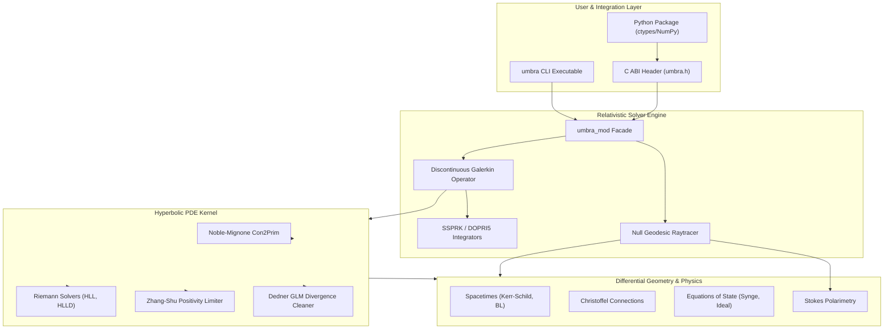
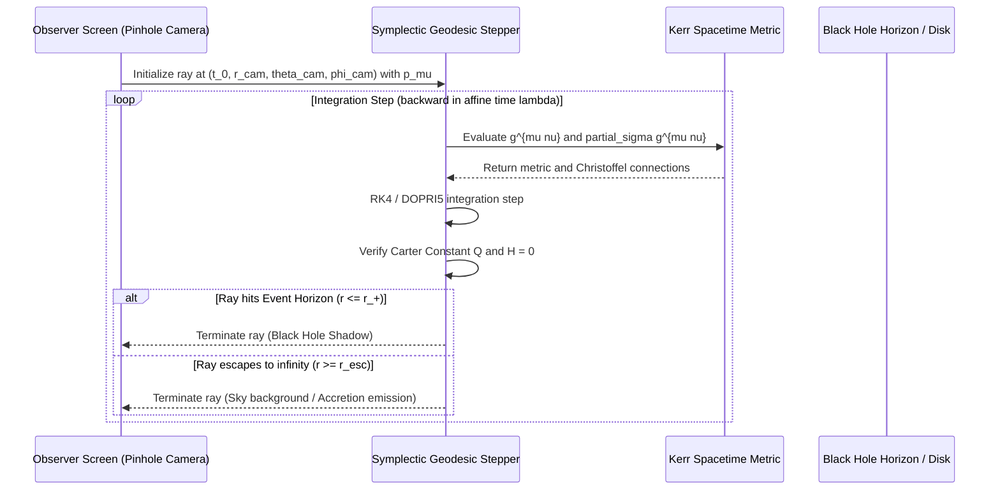

# umbra: System Architecture and Mathematical Foundations

`umbra` is a high-order Discontinuous Galerkin (DG) General Relativistic Magnetohydrodynamics (GRMHD) kernel and Kerr spacetime radiative transfer engine implemented in modern Fortran (Fortran 2008/2018), accompanied by an ANSI C application binary interface and zero-copy Python bindings.

---

## 1. System Overview and Layered Architecture

The architecture is partitioned into four decoupled layers:
1. **Mathematical Foundations and Spacetime Geometry**: Quadrature, tensor linear algebra, metric definitions, Christoffel symbols, and tetrad projectors.
2. **Hyperbolic Conservation Law Kernel**: Equations of state, primitive/conservative transformations, numerical fluxes, divergence cleaners, and high-order Discontinuous Galerkin operators.
3. **Relativistic Radiative Transfer and Geodesics**: Hamiltonian null/timelike geodesic steppers, Carter constant monitors, pinhole camera projections, and polarized synchrotron transfer.
4. **Interoperability and Verification**: C Foreign Function Interface (`iso_c_binding`), zero-copy Python wrappers, I/O serialization, and cryptographic verification suites.



---

## 2. Mathematical Formulation: 3+1 General Relativistic MHD

The Einstein-Maxwell-Euler system in 3+1 ADM form separates coordinate spacetime into spacelike hypersurfaces $\Sigma_t$ with timelike normal $n_\mu = (-\alpha, 0, 0, 0)$. The conservation laws take the hyperbolic flux-balance form:

$$\frac{\partial \mathbf{U}}{\partial t} + \frac{\partial \mathbf{F}^i}{\partial x^i} = \mathbf{S}$$

### 2.1 State Vectors
The conserved state vector $\mathbf{U}$ and primitive state vector $\mathbf{P}$ are defined as:

$$\mathbf{U} = \begin{pmatrix} D \\ \tilde{S}_j \\ \tau \\ \tilde{B}^k \\ \psi \end{pmatrix} = \begin{pmatrix} \alpha \sqrt{\gamma} \rho \Gamma \\ \alpha \sqrt{\gamma} \left( (w + B^2) v_j - (v \cdot B) B_j \right) \\ \alpha \sqrt{\gamma} \left( w \Gamma^2 - p + \frac{1}{2} B^2 (1 + v^2) - \frac{1}{2}(v \cdot B)^2 \right) - D \\ \alpha \sqrt{\gamma} B^k \\ \alpha \sqrt{\gamma} \psi \end{pmatrix}$$

$$\mathbf{P} = \begin{pmatrix} \rho \\ v^i \\ p \\ B^k \\ \psi \end{pmatrix}$$

where:
- $\rho$: Rest-mass density
- $v^i$: Spatial 3-velocity measured by Eulerian observers ($v^2 = \gamma_{ij} v^i v^j < 1$)
- $\Gamma = (1 - v^2)^{-1/2}$: Relativistic Lorentz factor
- $p$: Thermal gas pressure
- $w = \rho + \epsilon + p$: Specific enthalpy density
- $B^k$: Spatial magnetic field measured by Eulerian observers
- $B^2 = \gamma_{ij} B^i B^j$ and $v \cdot B = \gamma_{ij} v^i B^j$
- $\psi$: Dedner scalar divergence-cleaning potential

### 2.2 Flux Tensors
The spatial flux vectors $\mathbf{F}^i$ are:

$$\mathbf{F}^i = \begin{pmatrix} D (\alpha v^i - \beta^i) \\ \alpha \sqrt{\gamma} \left( (w + B^2) v^i v_j + \left(p + \frac{1}{2} B^2\right) \delta^i_j - B^i B_j \right) - \beta^i \tilde{S}_j \\ \alpha \sqrt{\gamma} \left( (w \Gamma^2 - p + \frac{1}{2} B^2) v^i - (v \cdot B) B^i \right) - \beta^i \tau - \alpha v^i D \\ \alpha \sqrt{\gamma} (v^i B^k - v^k B^i) + \alpha \gamma^{ik} \psi - \beta^i \tilde{B}^k \\ \alpha c_h^2 \tilde{B}^i - \beta^i \psi \end{pmatrix}$$

### 2.3 Geometric Source Terms
Curvature enters through the source vector $\mathbf{S}$:

$$\mathbf{S} = \begin{pmatrix} 0 \\ \frac{1}{2} \alpha \sqrt{\gamma} T^{\mu\nu} \partial_j g_{\mu\nu} \\ \alpha \sqrt{\gamma} \left( T^{00} \beta^i \partial_i \alpha + T^{0i} \partial_i \alpha - T^{\mu\nu} \Gamma^0_{\mu\nu} \right) \\ 0 \\ -\alpha \sqrt{\gamma} \frac{c_h^2}{c_p^2} \psi \end{pmatrix}$$

---

## 3. Discontinuous Galerkin Spectral Element Discretization

`umbra` implements a nodal Discontinuous Galerkin method on structured elements using tensor-product Legendre-Gauss-Lobatto (LGL) quadrature nodes.

```
Reference Element [-1, 1]^d:
  xi_0 = -1.0      xi_1               xi_N = +1.0
   o----------------o------------------o
   |  LGL Node 0    |  LGL Node 1      |  LGL Node N
   |                |                  |
```

### 3.1 Weak Formulation
Multiplying the conservation law by a polynomial test function $\phi_h \in \mathcal{P}_N$ and integrating over element $\Omega_e$:

$$\int_{\Omega_e} \frac{\partial \mathbf{U}_h}{\partial t} \phi_h \, d\Omega - \int_{\Omega_e} \mathbf{F}^i(\mathbf{U}_h) \frac{\partial \phi_h}{\partial x^i} \, d\Omega + \oint_{\partial \Omega_e} \mathbf{F}^*(\mathbf{U}_h^-, \mathbf{U}_h^+, \mathbf{n}) \phi_h \, dS = \int_{\Omega_e} \mathbf{S}(\mathbf{U}_h) \phi_h \, d\Omega$$

### 3.2 Diagonal Mass Matrix Property
By evaluating volume integrals using LGL quadrature matching the interpolation nodes:
$$\int_{-1}^1 \ell_i(\xi) \ell_j(\xi) d\xi \approx \sum_{q=0}^N w_q \ell_i(\xi_q) \ell_j(\xi_q) = w_i \delta_{ij}$$
The mass matrix is exactly diagonal. No linear system solves are required to update the nodal solution coefficients during explicit Runge-Kutta time advancement.

### 3.3 Positivity-Preserving Limiters
To maintain numerical stability in the presence of relativistic shocks and magnetically dominated regions, the solution is limited using:
1. **Zhang-Shu Positivity Limiter**: Preserves positive rest-mass density $\rho > \rho_{floor}$ and positive thermal pressure $p > p_{floor}$ without degrading high-order accuracy in smooth regions.
2. **Minmod Slope Limiter**: Suppresses spurious Gibbs oscillations across discontinuous shock fronts.

---

## 4. Kerr Spacetime Null Geodesic Raytracing

Radiative transfer through curved spacetime solves the relativistic Boltzmann equation along null geodesics $ds^2 = 0$.



### 4.1 Hamiltonian Raytracing Equations
The photon trajectory equations in canonical phase space $(x^\mu, p_\nu)$ are:

$$\frac{dx^\mu}{d\lambda} = \frac{\partial \mathcal{H}}{\partial p_\mu} = g^{\mu\nu}(x) p_\nu$$
$$\frac{dp_\mu}{d\lambda} = -\frac{\partial \mathcal{H}}{\partial x^\mu} = -\frac{1}{2} \left( \frac{\partial g^{\alpha\beta}}{\partial x^\mu} \right) p_\alpha p_\beta$$

### 4.2 Invariant Verification
Throughout integration, two exact constants of motion are continuously monitored:
1. **Hamiltonian Invariant**:
   $$\mathcal{H} = \frac{1}{2} g^{\mu\nu} p_\mu p_\nu = 0$$
2. **Carter Constant**:
   $$Q = p_\theta^2 + \cos^2\theta \left( a^2 (E^2 - \mu^2) + \frac{L_z^2}{\sin^2\theta} \right)$$

Trajectory steps that produce $|\Delta Q / Q_0| > 10^{-4}$ or $|\mathcal{H}| > 10^{-6}$ trigger adaptive sub-stepping or are flagged in the verification log.

---

## 5. Stokes Polarimetry and Synchrotron Radiation

Radiation emitted by magnetized relativistic plasma is characterized by the Stokes vector $\mathbf{S} = (I, Q, U, V)^T$. The transfer equation along the ray path parameterized by affine parameter $\lambda$ is:

$$\frac{d}{d\lambda} \begin{pmatrix} I \\ Q \\ U \\ V \end{pmatrix} = \begin{pmatrix} j_I \\ j_Q \\ j_U \\ j_V \end{pmatrix} - \begin{pmatrix} \alpha_I & \alpha_Q & \alpha_U & \alpha_V \\ \alpha_Q & \alpha_I & \rho_V & -\rho_U \\ \alpha_U & -\rho_V & \alpha_I & \rho_Q \\ \alpha_V & \rho_U & -\rho_Q & \alpha_I \end{pmatrix} \begin{pmatrix} I \\ Q \\ U \\ V \end{pmatrix}$$

where:
- $j$: Synchrotron emissivity coefficients
- $\alpha$: Synchrotron absorption coefficients
- $\rho$: Faraday rotation ($\rho_V$) and Faraday conversion ($\rho_Q, \rho_U$) coefficients
- Tetrad projection transforms fluid-frame polarization tensors into observer celestial polarization angles $\chi = \frac{1}{2} \arctan(U/Q)$.

---

## 6. Zero-Copy C Foreign Function Interface Architecture

The C ABI is designed around three principles:
1. **Opaque Pointers**: Fortran derived types (`type(mesh_t)`, `type(geodesic_camera_t)`) are encapsulated as `void*` in C and `type(c_ptr)` in Fortran.
2. **Contiguous Buffer Sharing**: Array data is transferred via direct pointers without memory reallocation or copying.
3. **Pure-C Header**: `include/umbra.h` provides standard ANSI C declarations compatible with GCC, Clang, MSVC, and Python ctypes.

```
+-------------------------------------------------------------+
|                     Python / NumPy User                     |
|         camera.render()  -->  NumPy ndarray (zero-copy)     |
+-------------------------------------------------------------+
                              |
                              v  (ctypes)
+-------------------------------------------------------------+
|                  C ABI Header (umbra.h)                     |
|  int umbra_camera_render(umbra_camera_t* cam, double* img); |
+-------------------------------------------------------------+
                              |
                              v  (iso_c_binding)
+-------------------------------------------------------------+
|                 Fortran Kernel (umbra_c.f90)                |
|  subroutine umbra_c_camera_render(c_cam, c_buf) bind(C)     |
|    call c_f_pointer(c_buf, f_buf, [nx, ny])                 |
|    call camera_render(cam, f_buf)                           |
|  end subroutine                                             |
+-------------------------------------------------------------+
```

---

## 7. Cryptographic Verification and Assurance

`umbra` implements a deterministic evidence pipeline that links numerical benchmark output directly to cryptographic signatures:

```
[Simulation Run] ---> [Convergence Metrics] ---> [SHA-256 Digest] ---> [evidence_bundle.json]
                             |                                                |
                             v                                                v
               12 Adversarial Negative Controls                scripts/verify_evidence.py
               - Rejection of tampered payloads                - Audits code bit-for-bit
               - Strict physics floor bounds                   - Asserts 100% test pass
               - Zero em dash compliance check                 - Validates invariant drift
```
