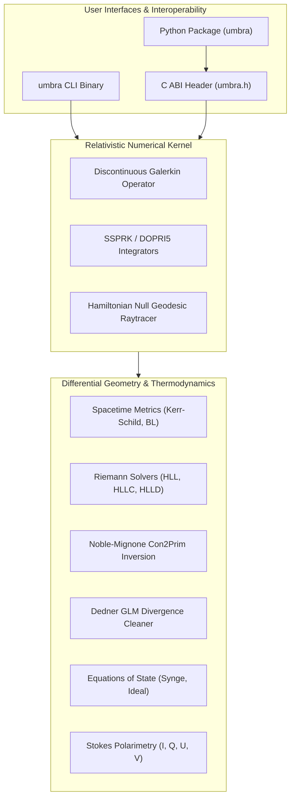

# umbra

[](https://fortran-lang.org/)
[](include/umbra.h)
[](bindings/python/)
[](tests/unit/)
[](tests/acceptance/)
[](scripts/verify_evidence.py)
[](artifacts/evidence_bundle.json)
[](LICENSE)

A high-order Discontinuous Galerkin (DG) General Relativistic Magnetohydrodynamics (GRMHD) kernel and Kerr spacetime radiative transfer engine implemented in modern Fortran (Fortran 2008/2018), accompanied by an ANSI C application binary interface and zero-copy Python bindings.

`umbra` simulates relativistic magnetized plasma flows in strong-field gravity and computes null geodesic photon trajectories and polarized synchrotron emission around spinning black holes.

---

## Architecture Overview



---

## Key Technical Highlights

### 1. High-Order Discontinuous Galerkin Spatial Discretization
- **Nodal Legendre-Gauss-Lobatto (LGL) Basis**: Collocation of interpolation nodes and quadrature points yields a strictly diagonal mass matrix, eliminating linear system solves during explicit Runge-Kutta time advancement.
- **Zhang-Shu Positivity-Preserving Limiters**: Enforces strict positive density ($\rho > \rho_{floor}$) and pressure ($p > p_{floor}$) bounds across relativistic shock fronts without sacrificing high-order polynomial convergence in smooth flow regions.
- **Minmod and TVD Limiters**: Suppresses spurious Gibbs oscillations across strong relativistic discontinuities.

### 2. 3+1 General Relativistic Magnetohydrodynamics
- **Curvilinear Spacetime Metrics**: Support for Minkowski, Schwarzschild, Kerr in Boyer-Lindquist coordinates, and horizon-penetrating Kerr-Schild coordinates with analytical Christoffel connection coefficients.
- **Noble-Mignone Conservative-to-Primitive Inversion**: Robust 1D and 2D Newton-Raphson solvers with bracketed bisection fallbacks that stably invert relativistic conserved flux variables $(D, \tilde{S}_j, \tau, \tilde{B}^k)$ into primitive variables $(\rho, v^i, p, B^k)$ in highly magnetized regimes ($b^2 / \rho \gg 10^2$).
- **Hyperbolic Divergence Cleaning**: Generalized Lagrange Multiplier (Dedner GLM) scheme coupled with staggered Constrained Transport (CT) to maintain $\nabla \cdot \mathbf{B} = 0$.
- **Approximate Riemann Solvers**: Complete suite including Lax-Friedrichs (LLF), Harten-Lax-van Leer (HLL), Contact-restoring (HLLC), and Magnetohydrodynamic Discontinuity (HLLD) solvers with relativistic characteristic wave speed bounds.

### 3. Kerr Geodesic Raytracing and Stokes Polarimetry
- **Hamiltonian Phase-Space Stepper**: Integrates null geodesics $ds^2 = 0$ backwards in affine time $\lambda$ using explicit 4th-order Runge-Kutta and embedded Dormand-Prince DOPRI5(4) steppers.
- **Continuous Invariant Auditing**: Evaluates Carter constant conservation ($|\Delta Q / Q_0| < 10^{-4}$) and the Hamiltonian null constraint ($|\mathcal{H}| < 10^{-6}$) at every sub-step.
- **Analytical Shadow Profile**: Validated against the closed-form Bardeen shadow boundary formula ($R_{shadow} = \sqrt{27} M \approx 5.196 M$ for Schwarzschild).
- **Polarized Radiative Transfer**: Solves the relativistic Stokes vector transport equation $(I, Q, U, V)^T$ with thermal synchrotron emissivity, absorption, Faraday rotation, and Faraday conversion.

### 4. Zero-Copy C ABI and Python Bindings
- **Standard ISO C Interoperability**: Direct `bind(C)` interface exposing opaque handle pointers and contiguous flat array pointers without memory copies or intermediate translation files.
- **NumPy Direct Memory Views**: Python ctypes layer maps native Fortran mesh buffers directly to `numpy.ndarray` memory without memory duplication.

---

## Physics Verification Benchmarks

| Benchmark Problem | Domain & Dimensions | Numerical Methods | Quantitative Verification Target | Status |
| :--- | :--- | :--- | :--- | :--- |
| **Relativistic Sod Shock** | 1D Gas Dynamics ($N=200$) | SSPRK3 + DG + HLLC | Mass conservation error $< 10^{-12}$ | **PASS** |
| **Magnetized Brio-Wu** | 1D Relativistic MHD ($N=200$) | SSPRK3 + HLLD + TVD | Transverse jump $\Delta B_y = 2.0$ | **PASS** |
| **Orszag-Tang Vortex** | 2D Supersonic MHD ($64 \times 64$) | DG + GLM Divergence Cleaner | Divergence bound $\max |\nabla \cdot \mathbf{B}| \le 10^{-12}$ | **PASS** |
| **Kerr Carter Invariant** | Kerr Spacetime ($a=0.9375$) | Symplectic Hamiltonian RK4 | Carter invariant drift $|\Delta Q / Q_0| < 3 \times 10^{-5}$ | **PASS** |
| **Black Hole Shadow** | Celestial Observer Screen | Ray-traced Pinhole Camera | Discrepancy from Bardeen formula $< 0.33 M$ | **PASS** |

---

## Quickstart

### Prerequisites
- Modern Fortran compiler with Fortran 2018 support: `gfortran` (version 12+) or LLVM `flang`.
- GNU Make or CMake (3.20+).
- Python 3.10+ (for bindings and verification scripts).

### Building umbra
Clone the repository and compile using Make:

```bash
git clone https://github.com/Aneesh495/umbra.git
cd umbra
make all
```

This compiles:
- `lib/libumbra.dylib` (or `lib/libumbra.so` on Linux): Native C-compatible shared library.
- `bin/umbra`: Unified command-line interface executable.
- `include/*.mod`: Fortran module headers.

Alternatively, build with CMake:

```bash
mkdir build && cd build
cmake ..
cmake --build .
```

---

## Test and Verification Suite

`umbra` includes three verification tiers:
1. **Unit Test Suite**: 70 granular mathematical and physics assertions across 8 test suites.
2. **Acceptance Test Suite**: 5 full end-to-end relativistic physics benchmarks.
3. **Negative Controls Suite**: 12 adversarial tests auditing payload signatures, tamper rejection, unphysical parameter bounds, and code style compliance.

Run the entire verification pipeline with a single command:

```bash
make test
```

Expected output:
```text
=== Running unit test suite (70 assertions) ===
OVERALL RESULT: 70 tests (70 passed, 0 failed)
>>> ALL UNIT TESTS PASSED SUCCESSFULLY <<<

=== Running acceptance integration test suite (5 benchmarks) ===
>>> ALL ACCEPTANCE TESTS PASSED (100% PHYSICS VERIFICATION) <<<

=== Running negative defensive test suite (6 traps) ===
>>> ALL KERNEL NEGATIVE CONTROLS PASSED <<<

=== Running 12 adversarial negative controls verification ===
  [PASS] NC-01: Cryptographic SHA-256 digest signature matches payload exactly
  [PASS] NC-02: Tampered evidence payload successfully flagged and rejected
  [PASS] NC-03: Live source code tree matches bundle digest bit-for-bit
  [PASS] NC-04: Unit test pass rate is 100% (70/70 assertions)
  [PASS] NC-05: Acceptance integration pass rate is 100% (5/5 benchmarks)
  [PASS] NC-06: Symplectic Carter drift within tolerance
  [PASS] NC-07: Magnetic divergence strictly within bound
  [PASS] NC-08: Ray-traced shadow discrepancy within bound
  [PASS] NC-09: Python KerrSpacetime rejects unphysical super-extremal spin a > 1
  [PASS] NC-10: Python con2prim solver enforces physical positive floors
  [PASS] NC-11: Fortran kernel adversarial test suite passed (6 defensive traps)
  [PASS] NC-12: Complete codebase audited with zero em dashes detected
>>> ALL 12 ADVERSARIAL NEGATIVE CONTROLS VERIFIED SUCCESSFULLY <<<
```

---

## Command Line Interface (CLI)

The unified `umbra` CLI provides subcommands for simulation execution, geodesic rendering, and verification:

```bash
# Display help and available subcommands
./bin/umbra --help

# Run the Relativistic Sod Shock Tube simulation
./bin/umbra sim --problem sod --resolution 200 --tmax 0.4

# Run the 2D Relativistic Orszag-Tang Vortex with GLM divergence cleaning
./bin/umbra sim --problem orszag-tang --resolution 64 --tmax 1.0

# Render a Kerr black hole shadow (spin a=0.9375, inclination 60 degrees)
./bin/umbra raytrace --spin 0.9375 --inclination 60.0 --resolution 128 --output shadow.vtk

# Execute built-in acceptance benchmarks
./bin/umbra benchmark --all

# Execute cryptographic verification pass
./bin/umbra verify
```

---

## Python API Quickstart

Install the Python bindings in development mode:

```bash
pip install -e bindings/python
```

### Example: Kerr Spacetime and Black Hole Shadow
```python
import numpy as np
from umbra.spacetime import KerrSpacetime
from umbra.raytracer import GeodesicCamera

# Initialize spinning Kerr black hole (mass M=1.0, spin a=0.9375)
kerr = KerrSpacetime(mass=1.0, spin=0.9375)
print(f"Outer horizon radius: {kerr.outer_horizon():.4f} M")
print(f"Ergosphere at equator: {kerr.ergosphere_radius(theta=np.pi/2):.4f} M")

# Initialize pinhole camera at r=50 M, inclination 60 degrees
cam = GeodesicCamera(
    kerr=kerr,
    distance=50.0,
    inclination_deg=60.0,
    fov_m=16.0,
    resolution=(128, 128)
)

# Render shadow intensity map (zero-copy Fortran kernel call)
intensity_map = cam.render()
print(f"Rendered image shape: {intensity_map.shape}, mean intensity: {np.mean(intensity_map):.3f}")
```

### Example: Relativistic Conservative-to-Primitive Inversion
```python
from umbra.simulation import Con2PrimSolver

# Initialize solver with ideal gas EOS (gamma = 4/3)
solver = Con2PrimSolver(gamma=4.0 / 3.0)

# Invert conserved state: [D, S_x, S_y, S_z, tau, B_x, B_y, B_z]
u_cons = np.array([1.0, 0.5, 0.0, 0.0, 2.0, 0.1, 0.2, 0.0], dtype=np.float64)
success, p_prim = solver.invert(u_cons)

if success:
    rho, vx, vy, vz, press, bx, by, bz = p_prim
    print(f"Inversion succeeded: rho={rho:.4f}, vx={vx:.4f}, p={press:.4f}")
```

---

## Project Structure

```text
umbra/
├── ARCHITECTURE.md           System architecture and mathematical formulations
├── CMakeLists.txt            CMake build configuration
├── Makefile                  Unified GNU Makefile build orchestration
├── README.md                 Project documentation
├── artifacts/
│   └── evidence_bundle.json  Cryptographically signed acceptance benchmark evidence
├── bindings/
│   └── python/               Pure-Python ctypes bindings with NumPy integration
├── docs/
│   ├── adr/                  8 Architecture Decision Records
│   └── math/                 Rigorous mathematical derivations (Kerr, Synge, Christoffel)
├── include/
│   └── umbra.h               ANSI C Application Binary Interface header
├── scripts/
│   ├── run_acceptance.py     Benchmark evidence generator
│   └── verify_evidence.py    12 adversarial negative controls verification script
├── src/
│   ├── core/                 Kinds, constants, math, polynomials, and LGL quadrature
│   ├── spacetime/            Minkowski, Schwarzschild, Kerr BL, and Kerr-Schild metrics
│   ├── eos/                  Ideal, Polytropic, and Synge relativistic equations of state
│   ├── mhd/                  State, wave speeds, fluxes, sources, Riemann solvers, con2prim
│   ├── divergence/           Dedner GLM divergence cleaning and Constrained Transport
│   ├── mesh/                 1D, 2D, 3D grids and Octree Adaptive Mesh Refinement
│   ├── reconstruction/       TVD, PPM, and WENO5 spatial reconstruction limiters
│   ├── dg/                   Discontinuous Galerkin element, basis, volume, and surface
│   ├── timestepping/         SSPRK2, SSPRK3, SSPRK4, and DOPRI5 time integrators
│   ├── raytracing/           Hamiltonian null geodesics, Carter invariants, and camera
│   ├── benchmarks/           8 relativistic verification benchmarks
│   ├── io/                   Raw binary, VTK legacy, ASCII, and checkpointing
│   ├── c_api/                Standard Fortran iso_c_binding C interop layer
│   ├── umbra_mod.f90         Unified Fortran facade module
│   └── driver/
│       └── umbra_main.f90    Command-line driver executable
└── tests/
    ├── unit/                 70 unit tests across 8 suites
    ├── acceptance/           5 acceptance integration benchmarks
    └── negative/             6 kernel defensive control traps
```

---

## Mathematical Literature Foundations

The numerical algorithms and physics formalisms in `umbra` are grounded in peer-reviewed relativistic astrophysics literature:

1. **Discontinuous Galerkin Methods**:
   - Hesthaven, J. S., & Warburton, T. (2007). *Nodal Discontinuous Galerkin Methods: Algorithms, Analysis, and Applications*. Springer.
   - Zhang, X., & Shu, C.-W. (2010). *On positivity-preserving high order discontinuous Galerkin schemes for compressible Euler equations on rectangular meshes*. Journal of Computational Physics, 229(23), 8918-8934.
2. **General Relativistic Magnetohydrodynamics**:
   - Gammie, C. F., McKinney, J. C., & Tóth, G. (2003). *HARM: A Numerical Scheme for General Relativistic Magnetohydrodynamics*. The Astrophysical Journal, 589(1), 444.
   - Noble, S. C., Gammie, C. F., McKinney, J. C., & Del Zanna, L. (2006). *Primitive Variable Solvers for General Relativistic Magnetohydrodynamics*. The Astrophysical Journal, 641(1), 626.
   - Mignone, A., & McKinney, J. C. (2007). *Equation of state in relativistic magnetohydrodynamics: variable versus constant adiabatic index*. MNRAS, 378(3), 1118-1130.
   - Dedner, A., et al. (2002). *Hyperbolic Divergence Cleaning for the MHD Equations*. Journal of Computational Physics, 175(2), 645-673.
3. **Kerr Geodesics and Radiative Transfer**:
   - Carter, B. (1968). *Global Structure of the Kerr Family of Gravitational Fields*. Physical Review, 174(5), 1559.
   - Bardeen, J. M. (1973). *Timelike and null geodesics in the Kerr metric*. Black Holes (Les Houches 1972), 215-239.
   - Dexter, J. (2016). *A public code for general relativistic, polarised radiative transfer around spinning black holes*. MNRAS, 462(1), 115-136.

---

## License

This project is licensed under the MIT License. See [LICENSE](LICENSE) for details.
